<h1 align="center">Hi, I'm Al Zobaer 👋</h1>

  <b>PhD Candidate · Graduate Research Assistant @ <a href="https://github.com/MinenoLab">Mineno Lab</a>, Shizuoka University 🇯🇵</b> 
  Agricultural Robotics · 3D/4D Gaussian Splatting · Plant Phenotyping · Physical AI

  
  
  
  

---

### 🔬 Research

I build robots that **see crops in 3D, over time**. My work focuses on scale-invariant plant phenotyping and autonomous, time-series data acquisition in tomato greenhouses:

- 🤖 **Robotic sensing platforms**: a low-cost autonomous UGV with ROS 2 navigation and self-charging, and a **Unitree Go2** quadruped with a D1 arm, Livox Mid-360 LiDAR and RealSense depth camera
- 🌱 **3D → 4D reconstruction**: 3D Gaussian Splatting pipelines for individual tomato plants, now extending to **4DGS** to track growth over time
- 📐 **Phenotyping**: point-cloud analysis and trait extraction for plant digital twins
- ⚡ **Edge to server**: embedded control (Raspberry Pi, STM32), edge AI (Hailo-8L), wireless data transfer and server-side data management

### 🚀 Featured projects

| Project | What it is |
|---|---|
| [**3dgs-pipeline-manual**](https://github.com/alzobaer/3dgs-pipeline-manual) | End-to-end 3DGS pipeline for time-series plant phenotyping, from video capture to trait extraction ([docs site](https://alzobaer.github.io/3dgs-pipeline-manual/)) |
| [**3dgs-data-annotation-manual**](https://github.com/alzobaer/3dgs-data-annotation-manual) | Bilingual (日本語 / English) data collection & annotation manual for greenhouse crop monitoring |
| [**UGV-ROS2-MAVROS-Pixhawk**](https://github.com/alzobaer/UGV-ROS2-MAVROS-Pixhawk) | ROS 2 Jazzy + MAVROS on Raspberry Pi 5 with a Pixhawk flight controller: the UGV's control stack |
| [**STM32_Microcontroller_Development**](https://github.com/alzobaer/STM32_Microcontroller_Development) | Register-level STM32 programming: GPIO, UART, SPI, I2C |
| [**alzobaer.github.io**](https://github.com/alzobaer/alzobaer.github.io) | My academic website |

### 📄 Publications

- **Al Zobaer**, S. Watanabe, M. Koike, H. Mineno, "A Low-Cost Autonomous UGV with Self-Charging Capability for Efficient Greenhouse Monitoring," *2025 IEEE 14th Global Conference on Consumer Electronics (GCCE)*, Osaka, Japan, 2025. [[DOI]](https://doi.org/10.1109/GCCE65946.2025.11274833)
- Journal paper on 3DGS-based time-series plant phenotyping: *under review* at Computers and Electronics in Agriculture

### 🛠️ Tech stack

**Research areas:** 3D Gaussian Splatting · NeRF · Point Clouds · Computer Vision · Multimodal Sensing · Digital Twins · Edge AI · IoT

### 🤝 Open to

Research collaborations in agricultural robotics, 3D vision and Physical AI, and **part-time research / engineering roles** during my PhD.

<i>English · বাংলা · 日本語</i>

